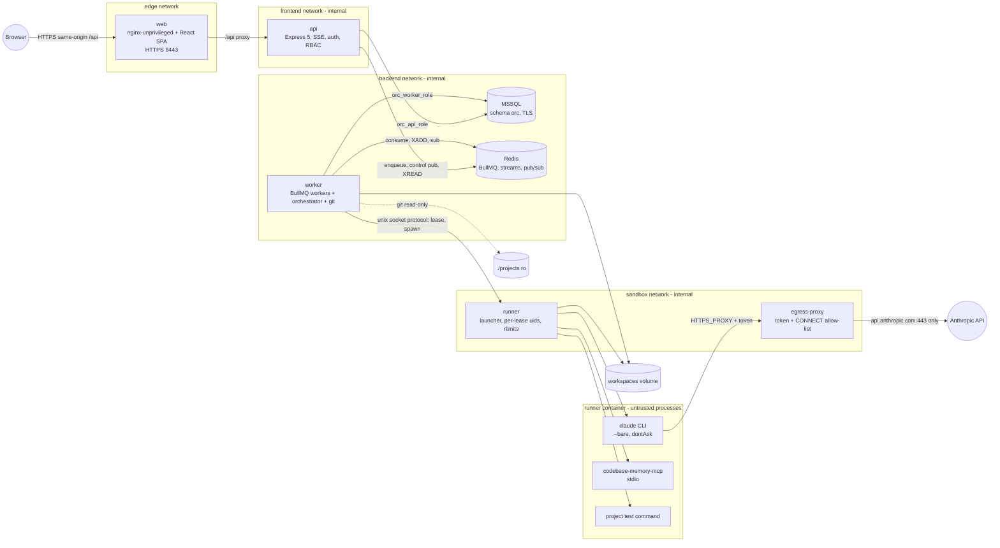
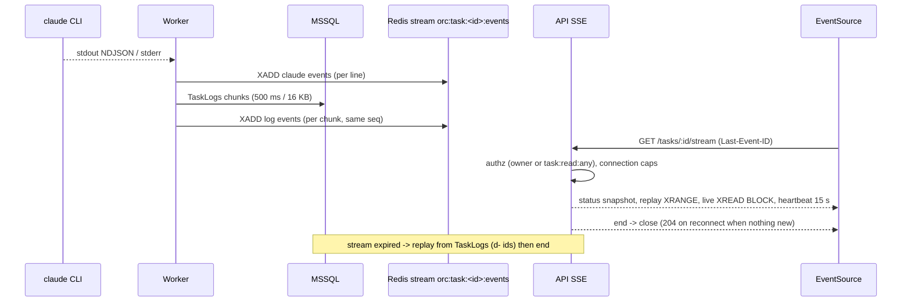
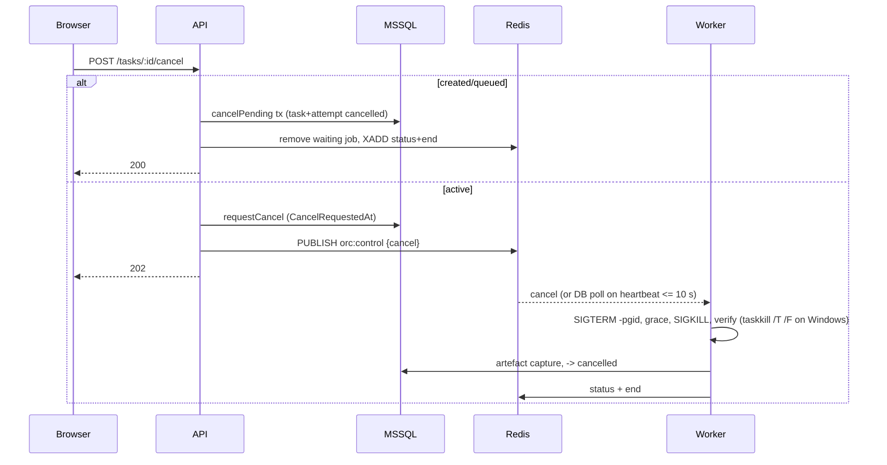
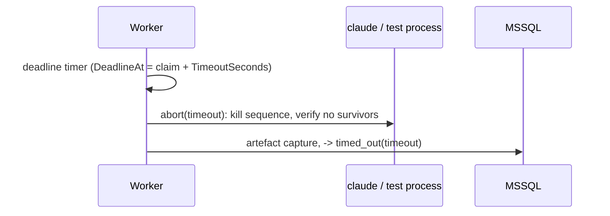

# Orc architecture overview

Binding details live in [contract.md](contract.md); section numbers below refer to it.

## Components



Package layering (§1.2): `shared <- security <- logger <- database <- task-manager <- project-manager <- api`; `git-manager, mcp-manager, claude-runner, task-manager <- orchestrator <- worker`; `sandbox <- worker, runner`; `web -> shared` only. Untrusted processes run only in the runner (§10.11, ADR-0024).

## Submit

```mermaid
sequenceDiagram
  participant U as Browser
  participant A as API
  participant D as MSSQL
  participant Q as Redis/BullMQ
  U->>A: POST /api/v1/tasks (Idempotency-Key, X-CSRF-Token)
  A->>D: tx: Task(created->queued) + Attempt#1(queued) + TaskEvents + AuditLogs + IdempotencyKeys(completed)
  A->>Q: add run-attempt jobId=attemptId (after commit)
  A->>Q: XADD status queued
  A-->>U: 202 Task + Location
  Note over A,Q: enqueue failure -> still 202; queued-reconciler re-adds within 60 s
```

## Execute

```mermaid
sequenceDiagram
  participant Q as BullMQ
  participant W as Worker pipeline
  participant D as MSSQL
  participant G as git
  participant M as codebase-memory-mcp
  participant C as claude CLI
  Q->>W: run-attempt
  W->>D: claimAttempt (CAS queued->preparing_workspace, DeadlineAt)
  W->>G: fetch mirror, worktree add -b orc/task-<k>-a<n>
  W->>D: -> indexing
  W->>M: index_repository(worktree, name orc-t-...)
  W->>D: -> running
  W->>C: spawn argv (§10.2), prompt on stdin
  C-->>W: stream-json (init validated fail-closed)
  W->>D: -> testing; run test argv; JUnit -> TestResults
  W->>D: -> reviewing
  W->>G: add/commit, name-status, numstat, patch, format-patch, merge-tree
  W->>M: re-index (fast) + detect_changes
  W->>D: ChangedFiles, AttemptPatches, MergeCheck; -> completed
```

## Live output



## Cancel



## Timeout



## Retry

```mermaid
sequenceDiagram
  participant U as Browser
  participant A as API
  participant D as MSSQL
  participant Q as BullMQ
  U->>A: POST /tasks/:id/retry {mode: fresh|continue}
  A->>D: createAttempt(user_retry): settled -> queued, Attempt n+1
  A->>Q: add run-attempt jobId=newAttemptId
  A-->>U: 202
  Note over Q: fresh = new worktree from base; continue = reuse workspace + --resume --fork-session
```

## Crash recovery

```mermaid
sequenceDiagram
  participant W1 as Worker (crashed)
  participant W2 as Other worker / restarted W1
  participant D as MSSQL
  participant Q as BullMQ
  W1--xD: heartbeats stop
  W2->>D: stale-attempt-recovery (LastHeartbeatAt older than 60 s) or startup own-attempt scan
  W2->>W2: orphan sweep (registry + ORC_ATTEMPT_ID marker)
  W2->>D: recoverInterruptedAttempt: old attempt interrupted; new attempt (infra_recovery, resume) or cancelled/timed_out/failed(recovery_limit_reached)
  W2->>Q: add run-attempt
  Q->>W2: run-attempt -> reuse worktree, claude --resume <session> --fork-session
```
